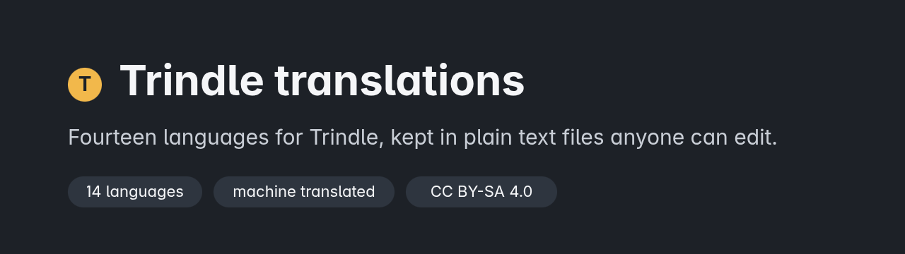
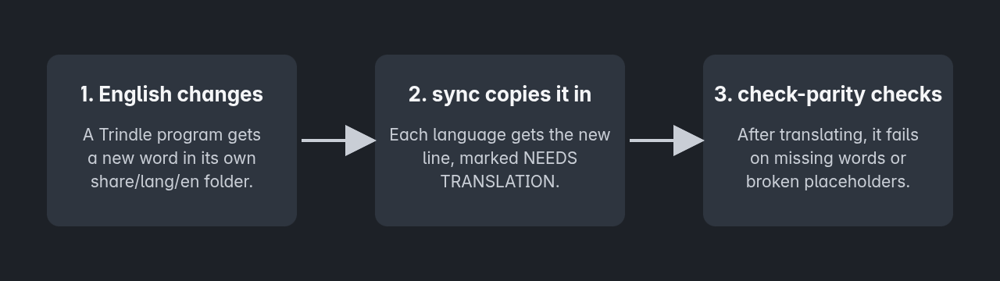

<p align="center"></p>

<p align="center">


</p>

The non-English words for Trindle: one folder per language code (es, fr, zh-Hans, hi, ar, pt-BR, ru, de, vi, id, tr, bn, sw, ur) plus the English variants en-GB, en-GB-oxendict and en-US. The English source lives in each Trindle program's own repository under `share/lang/en`.

Every message is a plain line in a text file, so anyone can correct a word with a text editor and no special tools. The small Rust tools here copy in new English words and check that a translation keeps its placeholders and plural forms.

## How it works

<p align="center"></p>

Machine translations are marked "machine translated". Lines marked `# SAFETY` (Allow, Deny, Delete, Cancel, permission prompts) are the first a reviewer should check; native review is planned after launch.

## Quick start

Build the tools:

```
cargo build --release
```

Copy the new English words into a language, then check it:

```
./target/release/sync fr <english folder>...
./target/release/check-parity fr <english folder>...
```

Open the new lines in a text editor, replace the English after each `=` sign, and run the check again. It must say `0 problems`. CONTRIBUTING.md has the full steps, including how to help without a terminal.

## What the tools do

- `sync <lang> <english dirs...>` copies new English keys in, marked as needing translation.
- `check-parity <lang> <english dirs...>` fails on missing keys, mismatched placeholders or plural forms, and em dashes.
- `docs-sync` and `docs-parity` do the same for the help pages.
- `variants` writes the English variant folders, holding only the words that differ.
- `sheet` and `import` make and read back a review spreadsheet, for people who prefer one.

The tools read and write local files only. They do not use the network.

## English variants

`en-GB` is Trindle's own English. `en-GB-oxendict` (Oxford spelling with -ize and the Oxford comma) and `en-US` (American) hold only the words that differ. A missing word falls back to English.

## Where the words live

Each folder holds the same file names and the same keys as the English source. Translators who correct a line are credited through the Buildmorphic community, by the name they choose.

## Security

The tools only handle text files. `SECURITY.md` says how to report a problem privately.

## Building it yourself

Rust only. `cargo build --release` builds every tool into `target/release`, and `cargo test` runs the tests.

## Help

Report bugs and ask questions on the Buildmorphic community: https://trindle.buildmorphic.com. See CONTRIBUTING.md to help translate.

Comments are stripped from the published code to keep it lean.

## Licence

The tools in `tools/` are under the GNU GPL version 3 or later (see [LICENSE](LICENSE)), the same as Trindle. The language files (the .ftl folders) are under Creative Commons Attribution-ShareAlike 4.0 (see [LICENSE-TRANSLATIONS](LICENSE-TRANSLATIONS)). The copyright holder is the Trindle project. The pictures in `docs/images` (the banner and the diagram, drawn from the files in `docs/images/sources`) are under the same Creative Commons licence as the language files. Changes by version are in [CHANGELOG.md](CHANGELOG.md).

## Disclaimer

Every language here is machine translated until a person who speaks it has reviewed it. The words are given as they are, without warranty of any kind.
